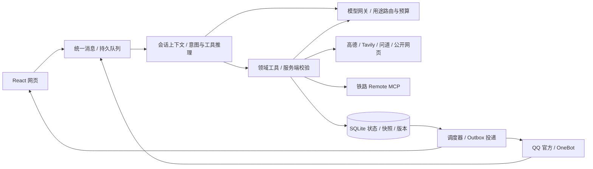

# 彼岸 · 旅行 Agent

一个从旅行资料研究、行程规划到出行提醒的 AI Agent。支持 **本地 Web** 和 **QQ** 两种交互入口：QQ 离线时，仍可在浏览器里使用同一套核心能力。

模型负责理解需求、识别上下文和选择工具；Python 服务负责查询真实数据、校验权限、保存版本与执行任务。行程、资料、提醒和任务状态持久化到 SQLite，重要修改先预览、再确认。

[Web 使用指南](docs/guides/web.md) · [QQ 使用指南](docs/guides/qq.md) · [全部指南](docs/guides/README.md)

当前同步版本的功能、升级步骤与验证说明见 [2026-11-09 更新记录](docs/releases/2026-11-09.md)。

## 能做什么

| 能力 | 使用示例与行为 |
| --- | --- |
| 联网攻略与景点研究 | 搜索公开攻略，整理景点文化、票价、开放与预约资料；展示来源、检索时间及未知项，支持继续规划 |
| 官网入口查询 | 查找景点官网与预约入口，分别展示身份核验、访问状态和待核实候选 |
| 双路线规划 | 启用问道后，分别生成基于高德资料的草案与问道草案，校验后选择或融合；可查看本轮两版方案及调整依据 |
| 行程规划与修改 | 规划 1–14 天城市行程；结合抵达、返程和每日可用时段安排，保留来源与版本；支持局部调整 |
| 草案接续与确认 | 采用历史方案、继续补充要求；支持重新核对、保存或放弃指定草案，确认前不写入正式行程 |
| 铁路 MCP 查询 | 查询指定城市/车站、日期及时段的车次、席别、参考票价与余票；支持往返交通、结果卡片及后续更正，不自动购票 |
| 独立酒店查价 | 无需先创建行程；补齐入住日期、人房条件后查价，支持选择门店、刷新、分批接续与查看历史原文；未知房价、税费和房态明确标注 |
| 酒店与餐饮候选 | 按明确品牌/集团、评分、预算和每日景点筛选，区分待核价酒店与可比参考报价；餐饮支持人均预算及单餐调整 |
| 消息引用与上下文 | 引用指定回复继续询问或修改，读取该消息的历史快照；本次要求接续当前草案，修改与保存仍校验最新版本 |
| 天气、地点与市内交通 | 查询天气、预报、地点和驾车／步行／公共交通路线；基于高德结果展示依据 |
| 文档与图片 | 导入 TXT、Markdown、DOCX、XLSX，检索相关片段；理解图片、提取预约规则 |
| 提醒与定时查询 | 一次性提醒、行程关联预约提醒、到点查询与规则监测；后端持续运行时执行 |
| 偏好记忆 | 明确保存长期旅行默认，本次要求优先；长期默认与当前行程分别修改 |
| 多供应商模型配置 | 保存多个连接与模型档案，按基础、常规、复杂及视觉用途分工；兼容旧配置，支持能力测试和按币种配置费率 |
| 用量、预算与诊断 | 按应用、会话和消息查看 token、调用与费用依据；按用途/连接统计，提供日月限额及处理过程诊断 |
| 可恢复任务与内容展示 | 持久化队列、取消、重启恢复及会话关联清理；支持 Markdown、表格、代码与 LaTeX 公式 |

例如，一次完整交互可以是：

```text
帮我搜索武汉三日游攻略
根据研究结果规划行程，10月1日到10月3日
我喜欢轻松一点的行程，不太喜欢打车，尽量步行或者公交地铁出行
确认行程修改
```

请将示例日期替换为实际出行日期。系统会继承已有行程信息，存在歧义时只追问缺少的部分；关联提醒变化会一并展示供确认。

## 选择入口

| 入口 | 适合场景 | 运行方式 |
| --- | --- | --- |
| **本地 Web** | 日常使用、调试 Agent、上传资料与管理多会话 | `python run_web.py`，默认 `http://127.0.0.1:8080` |
| **QQ · NapCat / OneBot** | 在已有 QQ 群内交互和接收提醒 | NapCat + 本地或服务器上的 OneBot 后端 |
| **QQ · 官方 Bot** | 已具备 QQ 开放平台应用与消息能力 | `python run_bot.py` |

Web 无需 QQ 凭据、NapCat 或 Docker。QQ 与 Web 默认使用独立数据目录；聊天和附件不会自动跨入口同步。Web 当前是单使用者的本机应用。

## 快速开始：Web

准备 **Python 3.11** 和 **Node.js 24**，在项目根目录执行以下 PowerShell 命令：

```powershell
python -m venv .venv
.\.venv\Scripts\Activate.ps1
python -m pip install -r requirements-web.txt -c constraints-py311.txt
Copy-Item .env.example .env
cd frontend
npm ci
npm run build
cd ..
python run_web.py
```

已有 `.env` 时跳过复制；已有 Python / Conda 环境可直接使用。Linux/macOS 的对应命令为：

```bash
python3.11 -m venv .venv
source .venv/bin/activate
python -m pip install -r requirements-web.txt -c constraints-py311.txt
cp .env.example .env
cd frontend
npm ci
npm run build
cd ..
python run_web.py
```

在 `.env` 或网页左侧“服务配置”中填写模型 `LLM_API_KEY`、`LLM_BASE_URL`、`LLM_MODEL_ID`，以及高德 Web 服务 `AMAP_API_KEY`。联网搜索另需 Tavily `SEARCH_API_KEY`。模型需支持 Chat Completions 与工具调用，识图还需支持图片输入；设置修改后重启后端。

首次构建后，日常运行只需 `python run_web.py`；Windows 也可使用 `start-web.cmd`。Node.js 仅用于前端开发和构建。端口、备份、删除会话、偏好范围及故障排查见 [Web 使用指南](docs/guides/web.md)；群配置与部署见 [QQ 使用指南](docs/guides/qq.md)。

## 核心设计与技术栈



- **前端**：React 19、TypeScript、Vite、原生 CSS；聊天、消息引用、铁路与酒店结果卡、两版草案比较及模型配置表单。
- **后端与业务**：Python 3.11、FastAPI、Uvicorn；统一请求路由，领域工具集中实现查询、研究、行程、酒店、预约、提醒与资料处理。
- **模型与提示词**：兼容 OpenAI Chat Completions；连接和模型档案按用途分工，Skill manifest 管理 20 个提示阶段及资源，请求使用冻结版本与内容哈希。
- **外部数据**：高德地图、Tavily、可选携程问道和公开网页；铁路使用 MCP Python SDK，通过 HTTPS Remote 的 Streamable HTTP 或 SSE 接入。
- **成本与可靠性**：结构化工具合同、身份与资源校验、持久检查点、预算账本和费率快照；未知提交保留占用，避免恢复时重复收费调用。
- **存储与检索**：SQLite、FTS5、消息/草案快照和按需摘要；仓库按领域拆分，可选本地 BGE 混合检索默认关闭，无需另部署向量数据库。
- **执行与验证**：Inbox 租约、可取消任务、调度器与 Outbox；统一离线评测和发布检查记录源码、提示资产及语料指纹。

```text
agents/          意图解析与有界工具推理
app/             请求路由、会话上下文与依赖组装
tools/           查询、酒店、研究、行程、资料、提醒及预约工具
services/        队列消费、后台调度与维护
infrastructure/  数据仓库、模型网关、外部 API 与 MCP 客户端
core/            消息、任务、配置、预算及业务合同
adapters/        Web、QQ 官方与 OneBot 接入
frontend/        React 网页
skills/          版本化提示片段、资源与阶段清单
prompts/         运行必需的摘要提示词
evaluation/      场景评测与执行模式
tests/ · evals/   自动化测试、夹具与静态场景数据
docs/            使用指南与发布记录
```

## 开发与验证

```powershell
python -m pip install -r requirements-dev.txt -c constraints-py311.txt
python -m pip check
python -X utf8 scripts/run_evaluations.py verify_v3_regression
python -X utf8 scripts/run_evaluations.py verify_v3_regression --frontend
python -X utf8 scripts/run_evaluations.py evaluate_tasks --output evals/ci-offline.json
python -X utf8 scripts/run_evaluations.py evaluate_retrieval --output evals/retrieval-v2-local.json
```

统一回归入口会自动将后端测试、前端测试和构建日志，以及 JSON 验收报告，保存到项目同级的 `travel_agent_val_log` 目录；本地路径为 `E:\Agent\travel_agent_val_log`。重复运行会覆盖同名文件；`--output` 可另行指定 JSON 报告路径。

离线测试使用模拟数据，不需要真实 API 密钥。CI 覆盖 Windows / Linux 后端测试，以及 Web 测试和构建。真实接口验收脚本见各入口指南；运行前需要配置对应服务，会消耗正常调用额度。

可复用评测数据和测试夹具随仓库提供；本地实验报告、模型原始调用记录和界面截图不作为运行依赖。发布前可以运行 `python scripts/check_secrets.py --all-tracked` 检查已纳入 Git 的文件。

## 数据与能力边界

- 行程修改先展示候选版本，确认后提交；仅保存长期默认不会自动重写旧行程。身份与资源权限由服务端绑定。
- `.env`、数据库、上传资料和运行日志不提交 Git。数据保存在本机，但模型、搜索与地图功能会将必要输入发送至已配置的外部服务。
- 提醒和监测需要后端持续运行；本地电脑休眠或关机期间无法准时执行。提醒不等于自动预约、购票或付款。
- 天气和交通结果受数据覆盖与时效限制；开放时间、实时价格、余票及道路封闭不保证被核实。
- Web 仅支持本机访问，尚未提供多人账号和公网部署。现有 NapCat Docker 配置不代表完整 Web 容器化已经验收。

详细功能变化、配置与升级步骤见 [发布记录](docs/releases/2026-11-09.md)，使用操作从 [指南目录](docs/guides/README.md) 查阅。
